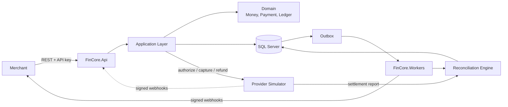

<div align="center">

# 💳 FinCore

**A production-grade payment processing, double-entry ledger and reconciliation platform.**

Built with C#, ASP.NET Core, EF Core and SQL Server.

[](https://github.com/<your-username>/FinCore/actions/workflows/ci.yml)
[](https://dotnet.microsoft.com/)
[](https://www.microsoft.com/sql-server)
[](https://www.docker.com/)
[](LICENSE)

[Overview](#-overview) · [Features](#-key-features) · [Architecture](#-architecture) · [Quick Start](#-quick-start) · [API](#-api-overview) · [Roadmap](#-implementation-roadmap) · [Testing](#-testing-strategy) · [Contributing](#-contributing)

</div>

---

## 📖 Overview

FinCore is the engine that sits behind products like **Paymob** or **Stripe**. It accepts payment requests from merchants, communicates with external payment providers, records every movement of money in an **immutable double-entry ledger**, and proves that its books agree with the provider's and the bank's through an automated **reconciliation engine**.

The platform is designed around three promises:

| Promise | How FinCore enforces it |
|---|---|
| **Never lose money** | Transactional outbox, durable raw-event storage, crash-safe workers |
| **Never create money** | Balanced journal entries, DB constraints, append-only ledger with hash chain |
| **Never charge twice** | Idempotency keys, provider-side idempotency, deduplicated webhooks |

> 🎓 FinCore is also a graduation project: every design decision is documented in [`docs/adr`](docs/adr) and the build is organised into 10 incremental phases (see [Roadmap](#-implementation-roadmap)).

---

## ✨ Key Features

- **Payment API** with merchant API-key authentication, cursor pagination and RFC 7807 error responses
- **Idempotency** on every mutating endpoint (insert-first pattern, request fingerprinting, safe under parallel retries)
- **Payment lifecycle state machine** (`Created → Processing → Authorized → Captured → Settled`, plus failure, cancel, expiry and refund paths) with full status history
- **Double-entry ledger**: chart of accounts, balanced journal entries, trial balance, pending vs. available merchant balances
- **Immutability**: no `UPDATE`/`DELETE` on ledger tables, reversal entries, SHA-256 hash chain for tamper evidence
- **Provider simulator** with chaos scenarios: declines, timeouts, 5xx, dropped responses, duplicate and out-of-order webhooks
- **Unknown-outcome handling**: timeouts never mean failure; payments are resolved by provider inquiry or webhook
- **Webhook ingestion** with HMAC signature verification, replay protection and deduplication
- **Transactional outbox** and signed outbound merchant webhooks with exponential-backoff retries and dead-lettering
- **Reconciliation engine**: three-way matching (internal ↔ provider report ↔ bank), discrepancy taxonomy, resolution through adjusting entries
- **Resilient background workers**: leasing, backoff with jitter, distributed locks, graceful shutdown
- **Security & observability**: RBAC, maker-checker approvals, audit log, rate limiting, Serilog, OpenTelemetry, Prometheus/Grafana
- **Docker & CI/CD**: one-command local stack, automated pipeline with test, coverage, vulnerability and image-scan gates

---

## 🏗 Architecture

FinCore is a **modular monolith** with clean layering, so module boundaries stay clear without the operational cost of microservices.



### Solution Structure

```text
FinCore/
├── src/
│   ├── FinCore.Domain/            # Entities, value objects (Money), state machine, ledger rules. No dependencies.
│   ├── FinCore.Application/       # Use cases, services, DTOs, validation, interfaces
│   ├── FinCore.Infrastructure/    # EF Core, repositories, provider client, caching, outbox
│   ├── FinCore.Api/               # Controllers, middleware, auth, OpenAPI
│   ├── FinCore.Workers/           # Hosted services: outbox, sweeper, reconciliation, integrity
│   └── FinCore.ProviderSimulator/ # Fake PSP with chaos scenarios and settlement reports
├── tests/
│   ├── FinCore.Domain.Tests/
│   ├── FinCore.Application.Tests/
│   ├── FinCore.IntegrationTests/  # Testcontainers + real SQL Server
│   └── FinCore.E2E.Tests/         # "Day in the Life" scenario
├── docs/
│   ├── adr/                       # Architecture Decision Records
│   ├── runbooks/                  # Operational procedures
│   └── blueprint.md               # Full 10-phase technical blueprint
├── deploy/                        # Dockerfiles, compose files, k6 scripts, Grafana dashboards
├── .github/workflows/             # CI/CD pipelines
└── docker-compose.yml
```

### Core Design Decisions

| Topic | Decision |
|---|---|
| **Money** | `long` minor units + ISO-4217 currency. Never `float`/`double`. 250.00 EGP is stored as `25000`. |
| **Time** | `DateTimeOffset`, UTC only |
| **IDs** | Internal `Guid` + public prefixed IDs (`pay_…`, `mer_…`, `je_…`) |
| **Errors** | RFC 7807 `ProblemDetails` with stable machine-readable `code` |
| **Concurrency** | `rowversion` optimistic concurrency, unique indexes and CHECK constraints as the last line of defence |
| **Consistency** | State change + ledger posting + outbox message commit in **one** DB transaction |

### The Five Golden Invariants

1. Sum of debits equals sum of credits, per journal entry and globally.
2. Ledger rows are never updated or deleted; corrections are new rows.
3. A payment only moves along legal state transitions.
4. Same idempotency key + same payload = same result, executed exactly once.
5. Every external fact (webhook, provider report) is stored raw before it is interpreted.

---

## 💰 How the Ledger Works

A captured payment of **250.00 EGP** with a 2.5% merchant fee produces one balanced journal entry:

| Account | Type | Debit | Credit |
|---|---|---:|---:|
| 1000 Provider Clearing | Asset | 25,000 | |
| 2000 Merchant Payable (Shop A) | Liability | | 24,375 |
| 4000 Fee Revenue | Revenue | | 625 |
| **Total** | | **25,000** | **25,000** |

Customer money is a **liability** (owed to the merchant), not revenue; only the fee is income. Settlement, payouts and refunds are further balanced entries, never edits.

---

## 🚀 Quick Start

### Prerequisites

- [.NET 8 SDK](https://dotnet.microsoft.com/download)
- [Docker Desktop](https://www.docker.com/products/docker-desktop/) (for SQL Server and the full stack)
- Optional: [k6](https://k6.io/) for load tests

### Run the Full Stack with Docker

```bash
git clone https://github.com/<your-username>/FinCore.git
cd FinCore
cp .env.example .env        # set SA password, webhook secrets, admin key
docker compose up --build
```

| Service | URL |
|---|---|
| FinCore API + Swagger | http://localhost:8080/swagger |
| Provider Simulator | http://localhost:8081 |
| Seq (logs) | http://localhost:5341 |
| Prometheus | http://localhost:9090 |
| Grafana | http://localhost:3000 |

### Run Locally (Development)

```bash
# 1. Start SQL Server only
docker compose up -d sqlserver

# 2. Apply migrations
dotnet ef database update --project src/FinCore.Infrastructure --startup-project src/FinCore.Api

# 3. Start the simulator, API and workers (separate terminals)
dotnet run --project src/FinCore.ProviderSimulator
dotnet run --project src/FinCore.Api
dotnet run --project src/FinCore.Workers
```

### Configuration

Secrets are never committed. Use environment variables or `dotnet user-secrets`.

| Variable | Description |
|---|---|
| `ConnectionStrings__Default` | SQL Server connection string |
| `Provider__BaseUrl` | Provider (simulator) base URL |
| `Provider__WebhookSecret` | HMAC secret for inbound provider webhooks |
| `Admin__BootstrapKey` | Initial admin credential for onboarding merchants |
| `Cache__Redis` | Optional Redis connection string |

---

## 🔌 API Overview

All endpoints are versioned under `/api/v1`. Merchant endpoints use the `X-Api-Key` header; mutating endpoints require `Idempotency-Key`.

| Area | Method & Route | Description |
|---|---|---|
| Merchants | `POST /merchants` | Onboard a merchant (admin) |
| Payments | `POST /payments` | Create payment (idempotent) |
| | `POST /payments/{id}/confirm` | Authorize via provider |
| | `POST /payments/{id}/capture` | Capture funds, posts ledger entry |
| | `POST /payments/{id}/cancel` | Void before capture |
| | `GET /payments/{id}` · `GET /payments` | Retrieve / list with cursor pagination |
| Refunds | `POST /payments/{id}/refunds` | Full or partial refund |
| Balance | `GET /merchants/me/balance` | Pending and available balances |
| Webhooks | `POST /webhook-endpoints` | Register merchant webhook URL |
| | `POST /webhooks/providers/simulator` | Inbound provider events (signature-verified) |
| Ledger (admin) | `GET /admin/ledger/trial-balance` | Trial balance, always nets to zero |
| | `GET /admin/ledger/integrity` | Hash-chain and projection verification |
| Reconciliation (admin) | `POST /admin/reconciliation/runs` | Run reconciliation for a date |
| | `GET /admin/reconciliation/discrepancies` | Work queue of discrepancies |

### Example: Create and Capture a Payment

```bash
# 1. Create
curl -X POST http://localhost:8080/api/v1/payments \
  -H "X-Api-Key: fc_test_xxx" \
  -H "Idempotency-Key: $(uuidgen)" \
  -H "Content-Type: application/json" \
  -d '{"amount": 25000, "currency": "EGP", "customerId": "cus_123", "description": "Order #1042"}'

# 2. Confirm with a simulator token
curl -X POST http://localhost:8080/api/v1/payments/pay_xxx/confirm \
  -H "X-Api-Key: fc_test_xxx" -H "Idempotency-Key: $(uuidgen)" \
  -H "Content-Type: application/json" \
  -d '{"paymentMethodToken": "tok_success"}'

# 3. Capture
curl -X POST http://localhost:8080/api/v1/payments/pay_xxx/capture \
  -H "X-Api-Key: fc_test_xxx" -H "Idempotency-Key: $(uuidgen)" \
  -H "Content-Type: application/json" \
  -d '{"amount": 25000}'
```

### Simulator Test Tokens

| Token | Behaviour |
|---|---|
| `tok_success` | Approved |
| `tok_decline_insufficient_funds` | Declined (code 51) |
| `tok_error_500` | Provider returns HTTP 500 |
| `tok_timeout` | Provider hangs; FinCore returns `pending_review` |
| `tok_success_no_response` | Provider approves but the response is lost (tests unknown-outcome recovery) |

---

## 🗺 Implementation Roadmap

FinCore is built in ten incremental phases. Each phase has a strict Definition of Done documented in the [technical blueprint](docs/blueprint.md).

| # | Phase | Focus | Status |
|:-:|---|---|:-:|
| 1 | Foundation & Payment API | Money value object, aggregates, API-key auth | ⬜ |
| 2 | Idempotency & Lifecycle State Machine | Safe retries, legal transitions, history | ⬜ |
| 3 | Double-Entry Ledger Core | Chart of accounts, balanced journal entries | ⬜ |
| 4 | Ledger Immutability, Reversals & Balances | Append-only data, refunds, hash chain | ⬜ |
| 5 | Provider Simulator & Timeouts | Unknown outcomes, resilience policies | ⬜ |
| 6 | Webhook Ingestion & Outbox Pattern | Signatures, dedup, reliable event delivery | ⬜ |
| 7 | Reconciliation Engine | Three-way matching, discrepancy detection | ⬜ |
| 8 | Workers, Retries & Caching | Leasing, backoff, DLQ, safe caching | ⬜ |
| 9 | Security & Observability | RBAC, audit, rate limits, metrics, tracing | ⬜ |
| 10 | Docker, CI/CD & Production Readiness | Containers, pipelines, load and chaos tests | ⬜ |

> ✅ Done · 🚧 In progress · ⬜ Planned. Update this table as phases are completed.

---

## 🧪 Testing Strategy

```bash
dotnet test                                   # all tests
dotnet test tests/FinCore.Domain.Tests        # fast, no database
dotnet test tests/FinCore.IntegrationTests    # spins up SQL Server via Testcontainers
k6 run deploy/k6/payments-load.js             # load test
```

| Level | What it proves |
|---|---|
| **Unit** | Money arithmetic, fee rounding, exhaustive state-machine matrix |
| **Integration** | Real SQL Server constraints, idempotency under parallel requests, outbox atomicity |
| **Concurrency** | 100 parallel refunds never exceed the captured amount; double-capture produces one entry |
| **Property-based (FsCheck)** | For any valid event sequence, total debits equal total credits |
| **Chaos** | Provider outages, dropped responses, duplicate and out-of-order webhooks, process kills |
| **Day in the Life (E2E)** | 1,000 payments with refunds, declines, timeouts and reconciliation; the books must balance |

---

## 🔐 Security

- API keys stored as hashes only; shown once at creation
- Tenant isolation through EF Core global query filters (`MerchantId`); foreign resources return `404`
- RBAC for staff, **maker-checker** approval for reversals and write-offs
- HMAC-SHA256 signed webhooks in both directions, with timestamp replay protection
- SSRF protection on merchant webhook URLs
- No card data stored: tokens only; log redaction for secrets and PAN-like values
- Append-only audit log and ledger enforced by DB permissions and triggers

Found a vulnerability? Please do **not** open a public issue. See [SECURITY.md](SECURITY.md).

---

## 📊 Observability

- **Logs:** Serilog (structured JSON) → Seq, with correlation IDs on every line
- **Metrics:** OpenTelemetry → Prometheus → Grafana (technical and business KPIs such as outbox backlog, stuck payments, unreconciled amount, ledger integrity failures)
- **Traces:** end-to-end trace from API request to outbox dispatch to merchant webhook delivery
- **Health:** `/health/live` and `/health/ready`

---

## 🛠 Tech Stack

| Layer | Technology |
|---|---|
| Language / Runtime | C# 12, .NET 8 |
| Web | ASP.NET Core Web API, FluentValidation, Swagger/OpenAPI |
| Data | EF Core 8, SQL Server 2022 |
| Resilience | Polly / `Microsoft.Extensions.Resilience` |
| Messaging | Transactional outbox (SQL Server) |
| Caching | `IMemoryCache`, optional Redis |
| Observability | Serilog, Seq, OpenTelemetry, Prometheus, Grafana |
| Testing | xUnit, FluentAssertions, Testcontainers, FsCheck, WireMock.Net, k6 |
| DevOps | Docker, Docker Compose, GitHub Actions, Trivy, gitleaks |

---

## 📚 Documentation

- [Technical Blueprint (10 phases)](docs/blueprint.md): concepts, endpoints, schemas and checklists per phase
- [Architecture Decision Records](docs/adr)
- [Runbooks](docs/runbooks): stuck payment, discrepancy handling, failed migration, backup restore
- [Glossary of FinTech terms](docs/glossary.md)

---

## 🤝 Contributing

Contributions, issues and feature ideas are welcome.

1. Fork the repository and create a branch: `git checkout -b feature/my-change`
2. Write tests first, especially for any ledger or state-machine change
3. Make sure `dotnet test` and `dotnet format --verify-no-changes` pass
4. Use [Conventional Commits](https://www.conventionalcommits.org/) (`feat:`, `fix:`, `docs:` …)
5. Open a pull request describing the change and the invariants it affects

---

## 📄 License

Distributed under the MIT License. See [LICENSE](LICENSE) for details.

---

## 👤 Author

**<Your Name>**
Graduation Project, <Your University / Faculty>, <Year>

[LinkedIn](https://linkedin.com/in/<your-handle>) · [GitHub](https://github.com/<your-username>) · <your.email@example.com>

<div align="center">

*If you find this project useful, please consider giving it a ⭐*

</div>
